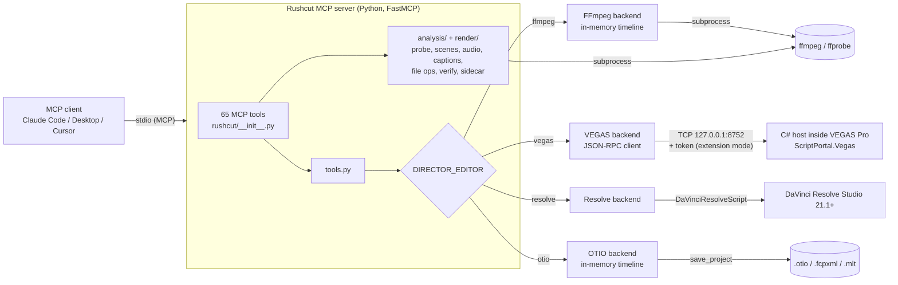

# Rushcut MCP

**Rushcut: AI video editing over MCP. Point any agent at your footage; get edits from FFmpeg, VEGAS Pro, DaVinci Resolve or an OTIO/FCPXML/MLT timeline.**

[](https://github.com/RFingAdam/rushcut/actions/workflows/ci.yml)
[](LICENSE)
[](server/pyproject.toml)
[](https://modelcontextprotocol.io)

Rushcut MCP is a [Model Context Protocol](https://modelcontextprotocol.io)
server (Python, [FastMCP](https://github.com/jlowin/fastmcp)) that exposes
**65 video-editing tools** to any MCP client: Claude Code, Claude Desktop,
Cursor, or anything else that speaks stdio MCP. The same tool names
(`add_track`, `place_media`, `trim_event`, `set_event_fades`,
`render_with_preset`, ...) drive whichever backend you select with
`DIRECTOR_EDITOR`, so an agent's workflow does not change when you switch
editors.

- **FFmpeg-first.** The headless backend keeps an in-memory timeline and
  renders with `ffmpeg`. No GUI editor, no license, runs on Windows, macOS and
  Linux.
- **Live NLE control when you want it.** Drive a running MAGIX VEGAS Pro
  (C# host over loopback TCP) or DaVinci Resolve Studio (official scripting
  API), and read the timeline back after every change.
- **Inspect, edit, verify.** Grounding tools (`probe_media`, `detect_scenes`,
  `analyze_audio`, optional local Whisper) and render checks
  (`verify_output`) let the model check its own work.

> **Formerly vegas-director-mcp.** Old import names, `python -m` entry
> points and console scripts keep working for one release, and MCP tool names
> are unchanged. See [docs/MIGRATION.md](docs/MIGRATION.md).

**Independent project.** Not affiliated with or endorsed by MAGIX or
Blackmagic Design. See [NOTICE](NOTICE).

## Contents

- [Backends](#backends)
- [60-second quickstart](#60-second-quickstart)
- [Register with your MCP client](#register-with-your-mcp-client)
- [Tool catalog](#tool-catalog)
- [Example: a headless FFmpeg edit](#example-a-headless-ffmpeg-edit)
- [Architecture](#architecture)
- [Configuration](#configuration)
- [Security](#security)
- [Troubleshooting](#troubleshooting)
- [Roadmap](#roadmap)
- [Contributing](#contributing)
- [License](#license)

## Backends

| `DIRECTOR_EDITOR` | Backend | Live? | Requirements | Notes |
|---|---|---|---|---|
| `ffmpeg` (aliases `ff`, `headless`) | Headless FFmpeg | No | `ffmpeg` + `ffprobe` on PATH | In-memory timeline, rendered to MP4 by `render_start` / `render_with_preset`. Transport tools are unsupported (no GUI). |
| `vegas` (default) | MAGIX VEGAS Pro via `ScriptPortal.Vegas` | Yes | Windows, licensed VEGAS Pro 22+ (VEGAS Pro 2027 is detected too) | C# host inside VEGAS on `127.0.0.1:8752`. Application Extension (auto-start) or Script Menu mode. Native Titles & Text, VideoMotion, render templates. |
| `resolve` (aliases `davinci`, `davinci-resolve`) | DaVinci Resolve via `DaVinciResolveScript` | Yes | **Resolve Studio 21.1+**, Preferences > System > General > External scripting = Local | The free edition has no scripting API since 21.1. Studio extras: subtitles from audio, Smart Reframe, voice isolation. |
| `otio` (aliases `fcpxml`, `mlt`, `kdenlive`, `shotcut`) | In-memory timeline interchange | No | Nothing extra | `save_project` writes `.otio`, `.fcpxml` or `.mlt`. Timeline I/O only, not a renderer. |

`vegas` stays the default so existing installs keep working. For a first run,
set `DIRECTOR_EDITOR=ffmpeg`. Call `list_editors`, `editor_info` and
`editor_capabilities` from the agent to see what the active backend implements
fully, partially, or not at all. Coverage details:
[docs/API_COVERAGE.md](docs/API_COVERAGE.md) and [docs/EDITORS.md](docs/EDITORS.md).

## 60-second quickstart

Requires Python 3.11+ and `ffmpeg` / `ffprobe` on PATH
(`winget install ffmpeg`, `brew install ffmpeg`, or `apt install ffmpeg`).
The package is not on PyPI yet, so install from a clone:

```bash
git clone https://github.com/RFingAdam/rushcut.git rushcut
cd rushcut/server
python -m venv .venv
source .venv/bin/activate          # Windows: .venv\Scripts\activate
pip install -e .                   # add ".[whisper]" for local transcription
```

Smoke-test it without an MCP client:

```bash
DIRECTOR_EDITOR=ffmpeg python -c "from rushcut.tools import ping; print(ping())"
# PowerShell: $env:DIRECTOR_EDITOR="ffmpeg"; python -c "from rushcut.tools import ping; print(ping())"
```

Run the server (stdio; your MCP client normally starts it for you):

```bash
DIRECTOR_EDITOR=ffmpeg rushcut-mcp      # or: python -m rushcut
```

Live editors need one more step: VEGAS host install in
[docs/SETUP.md](docs/SETUP.md), Resolve Studio setup in
[docs/RESOLVE.md](docs/RESOLVE.md). Headless details in
[docs/FFMPEG.md](docs/FFMPEG.md).

## Register with your MCP client

Point the client at the venv's Python (or the `rushcut-mcp` script inside
the venv). Use absolute paths. Replace `/path/to/rushcut` with your clone.

**Claude Code** (CLI):

```bash
claude mcp add rushcut --env DIRECTOR_EDITOR=ffmpeg -- /path/to/rushcut/server/.venv/bin/python -m rushcut
# Windows: ... -- C:\path\to\rushcut\server\.venv\Scripts\python.exe -m rushcut
```

**Claude Desktop** (`claude_desktop_config.json`; on Windows
`%APPDATA%\Claude\claude_desktop_config.json`, on macOS
`~/Library/Application Support/Claude/claude_desktop_config.json`):

```json
{
  "mcpServers": {
    "rushcut": {
      "command": "/path/to/rushcut/server/.venv/bin/python",
      "args": ["-m", "rushcut"],
      "env": { "DIRECTOR_EDITOR": "ffmpeg" }
    }
  }
}
```

On Windows you can instead run `py -3 scripts\register_claude.py` from the
repo root once the venv exists. It backs up the config, writes a
`"rushcut-mcp"` entry for this checkout, and leaves other entries alone.

**Cursor** (`~/.cursor/mcp.json`, or `.cursor/mcp.json` in a project):

```json
{
  "mcpServers": {
    "rushcut": {
      "command": "/path/to/rushcut/server/.venv/bin/python",
      "args": ["-m", "rushcut"],
      "env": { "DIRECTOR_EDITOR": "ffmpeg" }
    }
  }
}
```

Restart the client after editing its config. The server shows up as
**"Rushcut MCP"**. Existing configs that run an older module name such as
`-m vegas_director_mcp` keep working; switch them to `-m rushcut` when
convenient ([docs/MIGRATION.md](docs/MIGRATION.md)).

A ready-made agent skill that explains the typical tool flow lives in
[skills/rushcut/SKILL.md](skills/rushcut/SKILL.md).

## Tool catalog

65 tools, generated from the server's registered tool list. Tool names are
stable across backends; unsupported calls return `{"ok": false, ...}` with a
reason instead of raising.

| Category | Tools |
|---|---|
| Backend and session (6) | `list_editors`, `editor_info`, `editor_capabilities`, `ping`, `host_info`, `ensure_host` |
| Project (6) | `new_project`, `open_project`, `save_project`, `get_project_state`, `get_selected_events`, `set_project_video` |
| Media pool (4) | `import_media`, `list_media`, `replace_media`, `set_media_alpha` |
| Tracks (5) | `add_track`, `set_track_props`, `set_track_composite_level`, `clear_track_events`, `clear_envelope` |
| Clips / events (11) | `place_media`, `add_video_event`, `add_audio_event`, `add_title`, `trim_event`, `move_event`, `delete_event`, `set_event_fades`, `set_event_opacity`, `set_event_gain`, `set_motion_keyframes` |
| Mixing and transitions (3) | `set_envelope_points`, `apply_crossfade`, `apply_ducking` |
| Markers (3) | `add_marker`, `list_markers`, `delete_marker` |
| Transport, live NLEs only (3) | `transport_play`, `transport_stop`, `transport_seek` |
| Render and delivery (7) | `list_render_templates`, `render_start`, `render_status`, `wait_for_render`, `render_with_preset`, `verify_output`, `write_edit_sidecar` |
| Analysis, no NLE needed (4) | `probe_media`, `detect_scenes`, `analyze_audio`, `transcribe_media` |
| Captions, no NLE needed (2) | `generate_captions`, `burn_captions` |
| File-level FFmpeg ops, no NLE needed (5) | `cut_media`, `concat_media`, `reframe_media`, `mix_audio`, `normalize_audio` |
| Resolve Studio extras (3) | `resolve_create_subtitles`, `resolve_smart_reframe`, `resolve_set_voice_isolation` |
| Deprecated stubs (3) | `find_highlights`, `apply_vertical_short`, `propose_edit` (return a migration error; see [docs/MIGRATION.md](docs/MIGRATION.md)) |

Times on the wire are always **seconds** (`start_seconds`, `length_seconds`).
`length_seconds=-1` means "use the full remaining media length".
`render_with_preset` knows `vertical` (1080x1920), `1080p` and `4k`.

## Example: a headless FFmpeg edit

What an agent does through MCP, shown as the equivalent Python calls
(`rushcut.tools` is the same layer the MCP tools call):

```python
import os
os.environ["DIRECTOR_EDITOR"] = "ffmpeg"

from rushcut.analysis.probe import probe_media
from rushcut.tools import (
    new_project, set_project_video, add_track, add_video_event,
    trim_event, set_event_fades, render_with_preset,
)

print(probe_media("/media/raw.mp4"))          # duration, size, fps, audio

new_project(discard_unsaved=True)
set_project_video(1920, 1080, 30)
add_track("video", "V1")
add_video_event(0, "/media/raw.mp4", 0.0, -1)  # track 0, at 0 s, full length
trim_event(0, 0, length_seconds=8.0, take_offset_seconds=42.0)
set_event_fades(0, 0, fade_in_seconds=0.5, fade_out_seconds=0.5)

result = render_with_preset("/media/out.mp4", preset="1080p")
print(result)  # render result, ffprobe verification and the .edit.json sidecar path
```

The agent can also skip the timeline and work on files directly:
`cut_media`, `concat_media`, `reframe_media` (cover-crop to any size),
`mix_audio`, `normalize_audio` (EBU R128 `loudnorm`), then
`generate_captions` + `burn_captions`. See [docs/FFMPEG.md](docs/FFMPEG.md).

## Architecture



Every backend implements the same method protocol
(`server/rushcut/backends/protocol.py`), so `tools.py` never branches on the
editor. The VEGAS wire format is in [docs/PROTOCOL.md](docs/PROTOCOL.md).
For VEGAS, `ensure_host` picks a mode and reports it as `used_mode`: `live`
(host already listening), `launched_extension` / `launched_runscript`
(Rushcut starts VEGAS), or `oneshot_runscript` (generated script + job file).

## Configuration

All configuration is environment variables, usually set in the `env` block of
your MCP client config.

| Variable | Default | Purpose |
|---|---|---|
| `DIRECTOR_EDITOR` | `vegas` | Backend: `ffmpeg`, `vegas`, `resolve`, `otio` (aliases listed under [Backends](#backends)). `VEGAS_DIRECTOR_EDITOR` is a legacy alias. |
| `FFMPEG_BIN`, `FFPROBE_BIN` | PATH lookup | Absolute path to `ffmpeg` / `ffprobe` if they are not on PATH. |
| `VEGAS_HOST_TRANSPORT` | `tcp` | `tcp` (what the host listens on) or `pipe` (client-side only; the host does not listen on a pipe yet). |
| `VEGAS_HOST_ADDRESS` | `127.0.0.1` | Host address for the VEGAS RPC client. |
| `VEGAS_HOST_PORT` | `8752` | Host TCP port. |
| `VEGAS_HOST_PIPE_NAME` | `vegas-director` | Named pipe for `pipe` transport. |
| `VEGAS_HOST_TOKEN` | read from `%LOCALAPPDATA%\vegas-director-mcp\token` | Auth token for extension-mode hosts. |
| `VEGAS_HOST_TIMEOUT` | `60` | Per-request timeout in seconds (save / open / new / render use 1800). |
| `VEGAS_HOST_LAUNCH_WAIT` | `45` | Seconds `ensure_host` waits for a launched VEGAS to come up. |
| `VEGAS_EXE` | auto-detect (`vegas2027.exe`, `Vegas220.exe`) | VEGAS executable. `VEGAS220_EXE` is also read. |
| `VEGAS_HOST_SCRIPT` | `host/VegasDirectorHost.cs` in the checkout | Host script used for Script Menu / run-script launches. |
| `VEGAS_DOCUMENTS` | Windows Known Folder (OneDrive-aware) | Override the Documents folder used to find `Vegas Application Extensions`. |
| `RESOLVE_SCRIPT_API` | platform default | Folder containing `DaVinciResolveScript.py` (or its `Modules` folder). |
| `RESOLVE_SCRIPT_LIB` | platform default | Path to `fusionscript` library. |
| `RESOLVE_EXE` (or `RESOLVE_PATH`) | auto-detect | Resolve executable, for auto-launch. |
| `RESOLVE_NOGUI` | unset | `1` / `true` / `yes` launches Resolve with `-nogui`. |
| `RESOLVE_LAUNCH_WAIT` | `60` | Seconds to wait for a launched Resolve. |
| `RESOLVE_RENDER_WAIT` | `1800` | Max seconds for a blocking Resolve render. |
| `NLE_WHISPER_DEVICE` | auto (CUDA if available, else CPU) | Force `cpu` or `cuda` for `transcribe_media`. `VEGAS_WHISPER_DEVICE` also works. |
| `NLE_WHISPER_COMPUTE` | `float16` on CUDA, `int8` on CPU | faster-whisper compute type. `VEGAS_WHISPER_COMPUTE` also works. |

## Security

- **Loopback only.** The VEGAS host binds `IPAddress.Loopback`
  (`127.0.0.1:8752`); it never listens on a LAN interface. To drive VEGAS on
  another machine, use an SSH tunnel rather than changing the bind.
- **Token in extension mode.** The auto-starting Application Extension
  generates a random 32-byte token on first start, stores it in
  `%LOCALAPPDATA%\vegas-director-mcp\token`, and rejects any request without
  it (`-32001 Unauthorized`). The Python client reads the file automatically
  or takes `VEGAS_HOST_TOKEN`. Never commit that file.
- **Script Menu mode has no token.** When you start the host manually from
  *Tools > Scripting*, any local process can reach the port while it runs.
  Prefer extension mode on shared machines.
- **Local processes, local files.** Analysis and FFmpeg tools run `ffmpeg` /
  `ffprobe` as subprocesses (argument lists, no shell) and read and write the
  paths the agent passes. Run the server as a user that should have access to
  those files, and review what an agent renders or overwrites.
- **Resolve** is reached through Blackmagic's own scripting API with
  External scripting = Local; Rushcut opens no extra ports for it.

## Troubleshooting

| Symptom | Fix |
|---|---|
| `ffmpeg is not on PATH` | Install ffmpeg (it includes ffprobe) or set `FFMPEG_BIN` / `FFPROBE_BIN`. |
| Tools appear but every timeline call fails with a VEGAS connection error | You are on the default `vegas` backend. Set `DIRECTOR_EDITOR=ffmpeg`, or start VEGAS with the host (see [docs/SETUP.md](docs/SETUP.md)) and call `ensure_host`. |
| `-32001 Unauthorized: missing or wrong token` | Extension-mode host. Make sure the server runs as the same Windows user, or set `VEGAS_HOST_TOKEN` to the contents of `%LOCALAPPDATA%\vegas-director-mcp\token`. |
| Resolve backend says scripting is unavailable | You need Resolve **Studio** 21.1+ with External scripting = Local. The free edition has no API. See [docs/RESOLVE.md](docs/RESOLVE.md). |
| `transcribe_media` returns a soft failure | Install the extra: `pip install -e ".[whisper]"`. |
| `ModuleNotFoundError: rushcut` after pulling | Re-run `pip install -e .` in `server/.venv` so the new package and console scripts are registered. |
| `DeprecationWarning: '<old name>' is deprecated` (for example `vegas_director_mcp`) | Harmless (stderr only). Switch your client config to `-m rushcut`. |
| Transport tools return `unsupported` | Expected on `ffmpeg` and `otio`; there is no playback UI. |
| Client does not show the server | Use absolute paths for `command`, check the client's MCP log, and restart the client after editing its config. |

## Roadmap

Done: shared backend protocol; FFmpeg, VEGAS Pro, Resolve Studio and
OTIO/FCPXML/MLT backends; media grounding, captions, file-level ops; async
render with presets, ffprobe verification and sidecars; VEGAS dual-mode host
(extension auto-start or run-script). Next:

- Publish `rushcut-mcp` to PyPI so `pip install rushcut-mcp` works.
- VEGAS host marker RPC (markers soft-fail on VEGAS today) and a named-pipe
  listener to match the client transport.
- More live NLE adapters (survey and candidates in
  [docs/EDITORS.md](docs/EDITORS.md)).

Full history and non-goals: [docs/ROADMAP.md](docs/ROADMAP.md).

## Contributing

Issues and PRs are welcome. Tests mock the VEGAS host, inject a fake Resolve
API and generate tiny clips with ffmpeg, so no editor is needed:

```bash
cd server
pip install -e ".[dev]"
pytest -q
ruff check .
```

If you change a host method or MCP tool, update
[docs/API_COVERAGE.md](docs/API_COVERAGE.md) and
[docs/PROTOCOL.md](docs/PROTOCOL.md) in the same PR. More in
[CONTRIBUTING.md](CONTRIBUTING.md).

| Path | What |
|---|---|
| `server/rushcut/` | FastMCP server, tool facade, backends, analysis, render helpers |
| `server/vegas_director_mcp/` and the other legacy alias packages | Deprecated aliases for `rushcut` (one release; see [docs/MIGRATION.md](docs/MIGRATION.md)) |
| `host/` | VEGAS C# host (`VegasDirectorHost.cs`), Application Extension wrapper, `build.ps1` |
| `scripts/register_claude.py` | Write a Claude Desktop entry for this checkout (Windows) |
| `skills/rushcut/SKILL.md` | Agent skill describing the tool flow |
| `server/tests/` | Mocked hosts and synthetic ffmpeg fixtures |
| `docs/` | Setup, FFmpeg, Resolve, protocol, API coverage, editors, roadmap, migration, licensing |

Inspired by [Bitwig MCP Server](https://github.com/WeModulate/bitwig-mcp-server)
and an early CC0-1.0 architecture sketch,
[MarcoRavich/VEGAS-AI-control](https://github.com/MarcoRavich/VEGAS-AI-control)
(no code reused verbatim).

## License

MIT. See [LICENSE](LICENSE). Trademark and affiliation notes are in
[NOTICE](NOTICE). GitHub may label the license "Other" because LICENSE also
carries MAGIX and CC0 notes; SPDX options are discussed in
[docs/LICENSING_OPTIONS.md](docs/LICENSING_OPTIONS.md). VEGAS, VEGAS Pro and
MAGIX are trademarks of MAGIX Software GmbH; DaVinci Resolve is a trademark of
Blackmagic Design.
